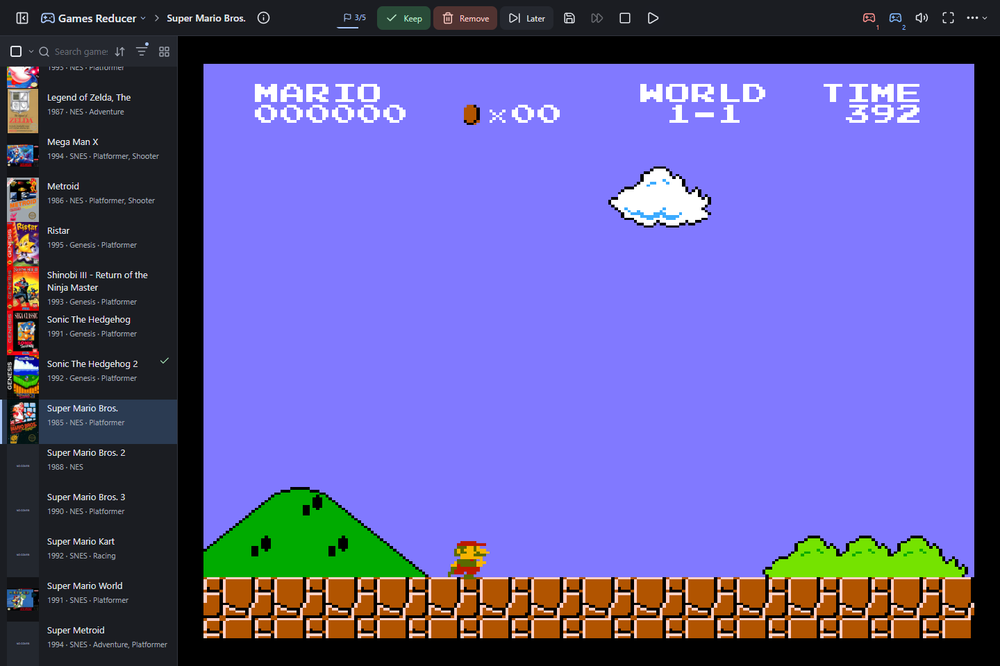
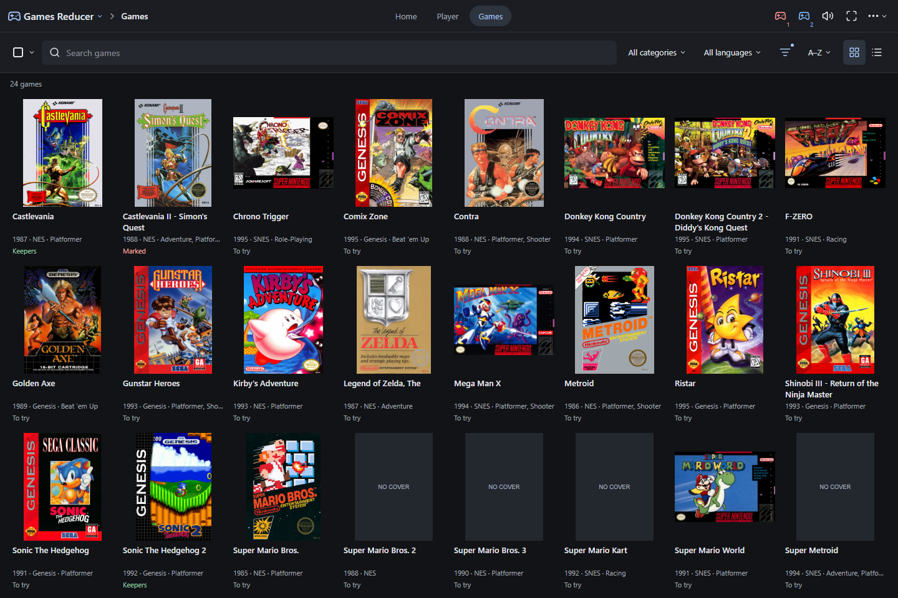
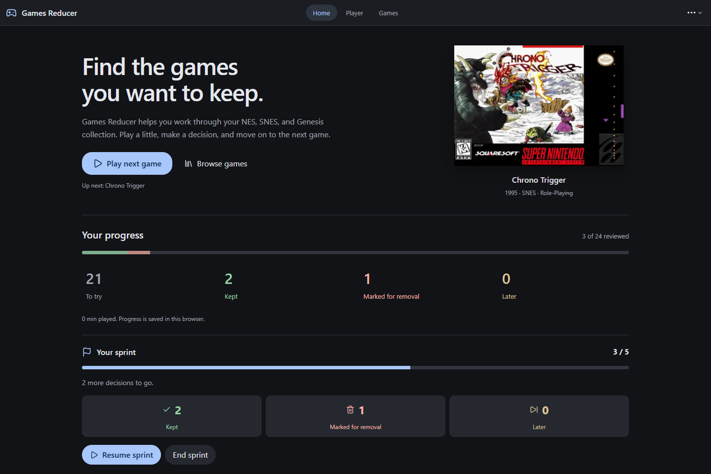

<p align="center">
  
</p>
<h1 align="center">Games Reducer</h1>
<p align="center">Find the games you actually want to keep.</p>
<p align="center">
  <a href="https://jelizarovas.github.io/games-reducer/">Open the app</a> ·
  <a href="#get-started">Get started</a> ·
  <a href="docs/guide.md">Full guide</a>
</p>

A big ROM collection is easy to collect and hard to get through. Games Reducer lets you play a little, keep what clicks, and mark the rest for removal. NES, SNES, and Genesis run in your browser.



## Get started

1. Open the app in desktop Chrome or Edge and choose your ROM folder.
2. Click a game to play with a controller, keyboard, or the on-screen pads.
3. Choose **Keep**, **Remove**, or **Later** to move on to the next game.

Games Reducer doesn't include ROMs or upload yours. Marking a game leaves its file alone. Finish session lets you review marked files and move them to a trash folder you choose.

## Make a dent in the pile

Browse covers in a grid or list. Filter by console, category, language, and review status. Select several games to review them together.

Start a sprint of 5 or more games. The header counts your decisions, then shows what you kept, marked, or left for later.

<table>
  <tr>
    <td width="50%"></td>
    <td width="50%"></td>
  </tr>
  <tr><td align="center">Browse your collection</td><td align="center">Finish a small batch</td></tr>
</table>

## Pick up where you left off

Save states work on all three consoles. Export a backup to move your progress, cartridge saves, save states, and sprint to another device. Copy your ROM folder separately.

You can install the app and play offline after setup finishes. Progress stays in this browser, so export a backup before clearing site data.

Press <kbd>?</kbd> for shortcuts. Hold <kbd>Alt</kbd> to see key badges or <kbd>Tab</kbd> to fast-forward.

<details>
<summary>Run locally</summary>

Use Node 22.13 or newer.

```sh
npm ci
npm run dev
```

Open [localhost:3001](http://127.0.0.1:3001). Run `npm test` for tests or `npm run build` for a static build. See the [full guide](docs/guide.md) for deployment and emulator development.

</details>

<sub>Emulation by <a href="https://github.com/bfirsh/jsnes">JSNES</a> and <a href="https://github.com/jsgroth/jgenesis">jgenesis</a>. Metadata and artwork from Libretro, LaunchBox, and local gamelists. <a href="docs/guide.md#emulator-source">Licenses and corresponding source</a>.</sub>
